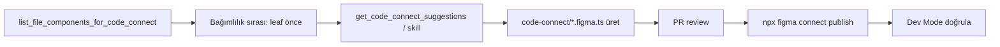

# Figma Code Connect — Eksiksiz Kurulum ve Kullanım Rehberi

Bu rehber, Figma'daki tasarım component'lerinizi (Button, Badge, Input, Modal vb.) kod tarafındaki gerçek component library'nize (örn. **Baklava React Native**, Tex Web UI Kit) **bağlamanın**, **toplu eşleştirmenin** ve bu bağlantıyı **Cursor + Figma MCP** ile kullanmanın güncel adımlarını kapsar (**CLI v2.1+**; interaktif wizard kaldırıldı).

---

> **Son güncelleme:** Kasım 2026 — `@figma/code-connect` **v2.1.0** ve Figma Remote MCP **figma-code-connect** skill ile uyumlu.

## İçindekiler

1. [Ön Gereksinimler](#1-ön-gereksinimler)
2. [Neden interaktif wizard kalktı?](#2-neden-interaktif-wizard-kalktı)
3. [Bölüm A — Code Connect CLI ile eşleştirme](#3-bölüm-a--code-connect-cli-ile-eşleştirme)
4. [Bölüm B — Figma Remote MCP ve toplu eşleştirme](#4-bölüm-b--figma-remote-mcp-ve-toplu-eşleştirme)
5. [Bölüm C — Custom Figma MCP Server ile kullanım](#5-bölüm-c--custom-figma-mcp-server-ile-kullanım)
6. [Hangi yöntemi seçmeliyim?](#6-hangi-yöntemi-seçmeliyim)
7. [Sık sorulan sorular](#7-sık-sorulan-sorular)
8. [Template API ile iç içe Code Connect (nested)](#8-template-api-ile-iç-içe-code-connect-nested)

---

## 1. Ön Gereksinimler

Başlamadan önce elinizde şunlar olmalı:


| Gereksinim                      | Açıklama                                                                                                                                                |
| ------------------------------- | ------------------------------------------------------------------------------------------------------------------------------------------------------- |
| **Figma dosyası**               | Tasarım component'lerinizin bulunduğu Figma Library dosyası (Button, Badge, Input vb. root component'ler burada olmalı — instance'lar değil, tanımlar). |
| **Component library repo'su**   | Kod tarafındaki component'lerinizin bulunduğu repo (örn. `@delivery/tex-web-ui-kit`, `@myteam/ui-kit` vb.).                                             |
| **Node.js 18+**                 | Code Connect CLI için gerekli.                                                                                                                          |
| **Figma hesabı**                | Organization veya Enterprise plan (Code Connect özelliği için).                                                                                         |
| **Figma Personal Access Token** | Figma → Settings → Personal Access Tokens'dan oluşturulur.                                                                                              |


### Figma Personal Access Token Oluşturma

1. [figma.com](https://www.figma.com/) adresine giriş yapın
2. Sağ üstteki profil resminize tıklayın → **Settings**
3. **Personal Access Tokens** bölümüne gidin
4. **Create a new personal access token** butonuna tıklayın
5. Token adı verin (örn. "Code Connect")
6. **Scope'ları** ayarlayın:
  - **Code Connect**: `Write` (eşleştirme yayınlamak için)
  - **File content**: `Read` (dosya içeriğini okumak için)
7. Token'ı kopyalayın (sadece bir kez gösterilir!)

Bu token'ı bir yere kaydedin, birden fazla adımda kullanacaksınız.

**Baklava React Native için:** Component'ler `src/components/<Ad>/<Ad>.tsx` altında; eşleştirme dosyalarını proje kökünde tutun (`code-connect/*.figma.ts` veya component yanında `*.figma.tsx`).

---

## 2. Neden interaktif wizard kalktı?

### Kısa cevap

**@figma/code-connect v2.1.0** (Ekim 2026) ile `npx figma connect` komutunun tek başına çalıştırılması artık **sihirbaz açmıyor**; yalnızca alt komutları listeliyor (`publish`, `create`, `parse`, …). Figma’nın resmi gerekçesi: **framework’e özel parser’lar** (React `.figma.tsx` + `figma.connect()`) bakım yükü oluşturuyordu; gelecekte **parserless Template API** (`.figma.ts` + `figma.code`) tek uzun vadeli format.

### Teknik arka plan


| Eski yaklaşım (wizard + parser) | Yeni yaklaşım (önerilen) |
| ------------------------------- | ------------------------ |
| CLI repo + Figma dosyasını tarayıp component çiftlerini soruyordu | **Figma Remote MCP** + **figma-code-connect** skill ile agent codebase’i tarar |
| Çıktı çoğunlukla `.figma.tsx` + `figma.connect()` | Çıktı **`ComponentName.figma.ts`** template dosyaları |
| Tek komutla toplu dosya üretimi | **Toplu iş:** `list_file_components_for_code_connect` → skill ile şablonlar → `publish` |
| Wizard içinde “Use AI for prop mapping” | `get_context_for_code_connect` + agent prop eşlemesi |

Figma [v2.1.0 release notları](https://github.com/figma/code-connect/releases/tag/v2.1.0): wizard yerine **`figma-code-connect` skill** kullanın ([skill kaynağı](https://github.com/figma/mcp-server-guide/blob/main/skills/figma-code-connect/SKILL.md)).

### “Otomatik eşleştirme” hâlâ var mı?

**Evet, ama yer değişti:**

1. **Figma MCP** — `get_code_connect_suggestions` AI önerileri; `list_file_components_for_code_connect` tüm library grafiği.
2. **Cursor / agent + figma-code-connect skill** — Önerileri codebase ile birleştirip `.figma.ts` dosyalarını üretir; siz onaylarsınız.
3. **CLI `create`** — Tek node için iskelet (template veya parser formatına göre sürüm).
4. **CLI `publish`** — Repodaki dosyaları Figma backend’ine yazar (asıl “canlıya alma” adımı).

Wizard’daki “tek terminal, 50 component” deneyimi → **MCP + skill + toplu publish** ile yapılıyor; eşleştirmeler yine **repoda versiyonlanır** (önerilen).

### İki dosya formatı (ikisini karıştırmayın)


| | Parser (legacy) | Template (önerilen) |
| --- | --- | --- |
| **Dosya** | `Button.figma.tsx` | `Button.figma.ts` |
| **API** | `figma.connect(Component, url, { props, example })` | `figma.selectedInstance`, `figma.code\`...\`` |
| **Import** | `@figma/code-connect` | `import figma from 'figma'` |
| **Bakım** | Framework parser’ları “legacy”; yeni özellikler template’te | Aktif geliştirme burada |
| **figma-code-connect skill** | **Kullanmaz** — mevcut `.figma.tsx`’e dokunma | **Sadece bunu üretir** |

Nested / karmaşık bileşenler (Modal, Table) için bu repoda [Bölüm 8](#8-template-api-ile-iç-içe-code-connect-nested) deseni geçerlidir.

---

## 3. Bölüm A — Code Connect CLI ile eşleştirme

Eşleştirmeler repoda dosya olarak yaşar; **Dev Mode** ve **MCP** veriyi Figma backend’inden okur. Yayınlamadan önce dosyaların repoda olması gerekir (MCP ile hızlı `send_code_connect_mappings` mümkün; aşağıda [4.4](#44-toplu-eşleştirme-üç-yol)).

### Adım 1: Code Connect CLI kurulumu

**Proje kökünde** (ör. `baklava-react-native`), sürüm kilidi için repoya devDependency eklemek en sağlıklısı:

```bash
npm install --save-dev @figma/code-connect@latest
```

Global kurulum da mümkün:

```bash
npm install --global @figma/code-connect@latest
```

Doğrulama — alt komutların listelenmesi **normaldir** (hata değil):

```bash
npx figma connect --help
# veya
npx figma connect publish --help
```

> **`components/` gibi alt klasörde** `npx figma connect` çalıştırmayın; `figma.config.json` genelde **repo kökündedir**.

### Adım 2: Token'ı Ortam Değişkeni Olarak Ayarlayın

Code Connect CLI komutları her çalıştırıldığında Figma token'ına ihtiyaç duyar. Bunu her seferinde `--token=...` yazarak geçebilirsiniz ama bu zahmetlidir. Bunun yerine token'ı bir **ortam değişkeni** olarak tanımlayın — CLI otomatik olarak `FIGMA_ACCESS_TOKEN` ortam değişkenini okur.

#### Yöntem A: Kalıcı ayarlama (önerilen)

Shell config dosyanıza ekleyin. Hangi shell kullandığınıza göre:

**zsh kullanıyorsanız** (macOS varsayılanı):

```bash
echo 'export FIGMA_ACCESS_TOKEN=figd_BURAYA_KENDI_TOKENINIZI_YAZIN' >> ~/.zshrc
source ~/.zshrc
```

**bash kullanıyorsanız**:

```bash
echo 'export FIGMA_ACCESS_TOKEN=figd_BURAYA_KENDI_TOKENINIZI_YAZIN' >> ~/.bashrc
source ~/.bashrc
```

Bu işlemi **bir kez** yapmanız yeterli. Bundan sonra her yeni terminal açtığınızda token otomatik tanımlı olur. Doğrulamak için:

```bash
echo $FIGMA_ACCESS_TOKEN
# Çıktı: figd_BURAYA_KENDI_TOKENINIZI_YAZIN
```

#### Yöntem B: Sadece mevcut terminal oturumunda

Kalıcı kaydetmek istemiyorsanız, terminal'de çalıştırın:

```bash
export FIGMA_ACCESS_TOKEN=figd_BURAYA_KENDI_TOKENINIZI_YAZIN
```

Bu **sadece açık olan terminal penceresi** için geçerlidir. Terminal'i kapatıp açtığınızda tekrar yazmanız gerekir.

#### Yöntem C: Komut başına (en güvensiz)

Ortam değişkeni ayarlamadan doğrudan komutta geçebilirsiniz:

```bash
npx figma connect --token=figd_BURAYA_KENDI_TOKENINIZI_YAZIN
```

Bu yöntem geçicidir ama token terminal geçmişinde kalır; güvenlik açısından Yöntem A tercih edilir.

### Adım 3: `figma.config.json` oluşturun (wizard artık yok — elle)

Eski rehberdeki `? Create figma.config.json?` sorusu kalktı. Dosyayı **repo kökünde** siz oluşturun.

**Baklava React Native önerilen başlangıç:**

```json
{
  "codeConnect": {
    "include": [
      "code-connect/**/*.figma.ts",
      "src/**/*.figma.tsx"
    ],
    "exclude": [
      "**/*.test.tsx",
      "**/*.stories.tsx",
      "**/__snapshots__/**"
    ],
    "label": "React",
    "language": "jsx",
    "parser": "react"
  }
}
```

- **`include`:** `publish` sırasında taranacak dosyalar. Template dosyaları (`*.figma.ts`) v2.1+ ile **varsayılan** olarak dahildir.
- **`label`:** Dev Mode’daki framework etiketi; React Native için genelde **`React`** (MCP `send_code_connect_mappings` de aynı label’ı kullanır).
- Nested Modal/Table için `code-connect/` klasörü — [Bölüm 8](#8-template-api-ile-iç-içe-code-connect-nested).

**TypeScript tip desteği** (template yazarken önerilir), `tsconfig.json`:

```json
{
  "compilerOptions": {
    "types": ["@figma/code-connect/figma-types"]
  }
}
```

### Adım 4: Eşleştirme dosyası üretin

Wizard kalktığı için dosyalar üç yoldan gelir; **ilk kurulum ve toplu iş için [Bölüm 4.4](#44-toplu-eşleştirme-üç-yol)** önerilir.

#### 4a. Tek component — CLI `create`

Figma’da **yayımlanmış** (team library) component’i seçin → **Copy link** (mutlaka `node-id` olsun):

```bash
cd /path/to/baklava-react-native
npx figma connect create "https://www.figma.com/design/FILE_KEY/...?node-id=65-5"
```

- Çıktıyı `code-connect/` veya component klasörüne taşıyın.
- v2.1+ çoğu zaman **template** iskeleti üretir; skill ile üretilen `.figma.ts` ile aynı hizada tutun.

#### 4b. Tek component — agent + `figma-code-connect` skill (önerilen)

Cursor’da Figma MCP bağlıyken örnek prompt:

```text
figma-code-connect skill kullan.
Figma URL: https://www.figma.com/design/FILE_KEY/Baklava?node-id=...
Kod: src/components/Button/Button.tsx ile eşle.
Template dosyasını code-connect/Button.figma.ts olarak yaz; figma.connect kullanma.
```

Skill kuralları: **yalnızca `*.figma.ts`**, `import figma from 'figma'`, üstte `// url=`, `// source=`, `// component=` yorumları.

#### 4c. Legacy parser — `figma.connect` (mevcut projeler)

Hâlâ desteklenir; yeni component’lerde **template tercih edin**. Örnek yapı:

```tsx
import { Button } from "../Button/Button"
import figma from "@figma/code-connect"

figma.connect(
  Button,
  "https://www.figma.com/design/XXXXX?node-id=65%3A5",
  {
    props: { /* Figma property adları */ },
    example: (props) => <Button {...props} />,
  },
)
```

**Kontrol listesi:** Figma property isimleri birebir mi? `example` gerçek API’nize uyuyor mu? RN’de import yolu `src/components/...` ile tutarlı mı?

#### Örnek template (kısaltılmış)

```ts
// url=https://www.figma.com/design/XXXXX/Baklava?node-id=65-5
// source=src/components/Button/Button.tsx
// component=Button
import figma from 'figma'
const instance = figma.selectedInstance

const label = instance.getString('Label')
const disabled = instance.getBoolean('Disabled')

export default {
  example: figma.code`<Button disabled={${disabled}}>${label}</Button>`,
  imports: ['import Button from "../src/components/Button/Button"'],
  id: 'button',
  metadata: { nestable: true },
}
```

Tam API: [figma-code-connect SKILL](https://github.com/figma/mcp-server-guide/blob/main/skills/figma-code-connect/SKILL.md).

### Adım 5: Yerelde önizleme (isteğe bağlı)

Publish etmeden Inspect benzeri çıktı:

```bash
npx figma connect preview code-connect/Button.figma.ts
```

### Adım 6: Figma’ya yayınlayın (`publish`)

```bash
# FIGMA_ACCESS_TOKEN tanımlıysa:
npx figma connect publish

# veya açık token:
npx figma connect publish --token=figd_XXX
```

**Yararlı bayraklar (v2.1+):**

| Bayrak | Ne işe yarar |
| ------ | ------------- |
| `--dry-run` | Yüklemeden deneme |
| `--exit-on-unreadable-files` | CI’da parse hatasında çık |
| `--force` | Figma UI’da oluşturulmuş çakışan mapping’lerin üzerine yazar |
| `-l React` | Label override |
| `-b 50` | Çok büyük batch’lerde “request too large” için |

Başarılı çıktı örneği:

```text
Published 4 Code Connect files:
  ✓ Button  → https://www.figma.com/design/XXXXX?node-id=65:5
  ...
```

**Önemli:** MCP `send_code_connect_mappings` backend’e yazabilir; ancak **kaynak kod repoda kalmaz**. Kalıcı kurulum için dosya + `publish` hattı standarttır.

### Adım 7: Doğrulama

1. Figma design system dosyası → **Dev Mode**
2. Component seç → **Inspect** → Code Connect snippet
3. Cursor’da: `get_code_connect_map` ile `fileKey` üzerinden harita

### Adım 8: Güncelleme ve bakım

| Durum | Ne yapın |
| ----- | -------- |
| Yeni Figma component | MCP/skill veya `create` → yeni `.figma.ts` → `publish` |
| Prop değişti | Template’i güncelle → `publish` |
| Mapping kaldır | `npx figma connect unpublish --node=URL --label=React` |
| Hepsini kaldır | `npx figma connect unpublish` (dikkatli kullanın) |

> **Geçmiş notu:** Eski `npx figma connect` wizard adımları (3a–3g) artık geçerli değil. Arşiv için [Code Connect v1.3 changelog](https://github.com/figma/code-connect/blob/main/CHANGELOG.md) bakılabilir.

### CLI komut özeti

| Komut | Açıklama |
| ----- | -------- |
| `npx figma connect publish` | Repodaki eşleştirmeleri Figma’ya yükler |
| `npx figma connect create <url>` | Tek node için dosya iskeleti |
| `npx figma connect parse` | JSON debug çıktısı (stdout) |
| `npx figma connect preview <dosya>` | Yerel önizleme |
| `npx figma connect migrate` | Parser dosyalarını template’e taşıma |
| `npx figma connect unpublish` | Backend’den kaldırma |

---

## 4. Bölüm B — Figma Remote MCP ve toplu eşleştirme

Code Connect **kurulumunun** çoğu artık burada: MCP araçları wizard’ın toplu tarama ve AI prop eşleştirmesinin yerini alır. Yayınlama hâlâ çoğunlukla **`npx figma connect publish`** ile repodan yapılır.

### Figma Remote MCP Nedir?

Figma'nın resmi MCP sunucusudur. Code Connect verisi dahil olmak üzere Figma'nın tüm özelliklerine erişim sağlar. **Masaüstü Figma uygulaması gerekmez**, sadece tasarım linki yeterlidir.

### Adım 1: Cursor'da MCP Ayarını Ekleyin

Proje kökünüzdeki `.cursor/mcp.json` dosyasına (veya kullanıcı seviyesinde Cursor → Settings → MCP):

```json
{
  "mcpServers": {
    "figma": {
      "url": "https://mcp.figma.com/mcp",
      "type": "http"
    }
  }
}
```

### Adım 2: Figma OAuth Bağlantısı

1. Cursor'da MCP sunucuları listesinde **figma**'yı bulun
2. **Start** butonuna tıklayın
3. Açılan pencerede **Connect** → Figma ile OAuth yapın (**Allow Access**)
4. Bağlantı başarılı olduğunda sunucu "Connected" durumuna geçer

Bu işlem **bir kez yapılır**; sonraki oturumlarda otomatik bağlanır.

### Adım 3: Kullanım

Cursor'da Composer'ı Agent modunda açın ve bir Figma linki ile çalışın.

#### Tasarım bağlamını almak için:

```
Şu Figma linkindeki frame'i incele ve React component'i oluştur:
https://www.figma.com/design/XXXXX/MyApp?node-id=1793-83734

get_design_context kullan, Code Connect'teki component'leri kullan.
```

AI, `get_design_context` tool'unu çağırır. Code Connect eşleştirmeleri yayınlanmışsa, yanıtta şu bilgiler gelir:

- Figma node yapısı (layout, renk, metin)
- **Code Connect eşleşmeleri** (örn. "Bu Button = kodunuzdaki `<Button variant="primary" />`)
- Prop mapping bilgisi

#### Mevcut eşleştirmeleri görmek için:

```
Bu Figma dosyasındaki Code Connect eşleştirmelerini göster:
get_code_connect_map kullan, fileKey: XXXXX
```

#### Eşleşme önerileri almak için:

```
Bu tasarımdaki component'ler için Code Connect önerileri al:
get_code_connect_suggestions kullan
```

### Adım 4: `figma-code-connect` skill’i etkinleştirin

Toplu eşleştirmede wizard’ın yerini bu skill alır. Kurulum seçenekleri ([Figma Help](https://help.figma.com/hc/en-us/articles/39166810751895)):

1. **Figma MCP eklentisi** — Cursor’da resmi Figma MCP kuruluysa skill’ler çoğu zaman **otomatik** gelir.
2. **Manuel** — [mcp-server-guide](https://github.com/figma/mcp-server-guide) içindeki `skills/figma-code-connect/` klasörünü agent’ınızın skill dizinine kopyalayın.

Skill çalışma özeti:

- Yalnızca **`*.figma.ts`** template üretir (`figma.connect` / `.figma.tsx` **üretmez**).
- `get_code_connect_suggestions` → eşleşmemiş yayımlanmış component’ler.
- `get_context_for_code_connect` → property listesi (VARIANT, BOOLEAN, SLOT, …).
- Codebase’de `src/components/` arar; eşleşmeyi **sizinle onaylar**.
- Çıktı: `code-connect/<Ad>.figma.ts` → siz commit edersiniz → **`publish`**.

### Figma Remote MCP — Code Connect araçları


| Araç | Ne zaman kullanılır |
| ---- | -------------------- |
| `list_file_components_for_code_connect` | **Toplu planlama:** Dosyadaki tüm **yayımlanmış** component’ler + bağımlılık grafiği (tek `fileKey`, `node-id` gerekmez) |
| `get_code_connect_suggestions` | Seçim/frame içinde **eşleşmemiş** component listesi ve AI öneri stratejisi |
| `get_context_for_code_connect` | Tek component için **property tanımları** (template yazımı) |
| `get_code_connect_map` | Mevcut backend eşleştirmeleri |
| `send_code_connect_mappings` | Onaylanan mapping’leri **toplu kaydet** (isteğe bağlı inline `template`) |
| `add_code_connect_map` | Tekil basit mapping |
| `get_design_context` | Tasarımdan kod — publish edilmiş CC snippet’leri dahil |
| `get_screenshot` / `get_metadata` | Büyük dosyalarda parçalı çalışma |

Diğer araçlar: `get_variable_defs`, tasarım üretim skill’leri (`figma-use`, …).

### 4.4. Toplu eşleştirme (üç yol)

#### Yol A — Önerilen: Repo + MCP + skill + `publish`

Tüm Baklava library’si için tipik akış:



**Adım adım (Cursor Agent):**

1. **Figma MCP OAuth** bağlı olsun (yukarıdaki OAuth adımı).
2. Design system **fileKey** veya tam URL verin. Örnek prompt:

   ```text
   Baklava Figma design system için toplu Code Connect kur:
   fileKey: QiEF6w564ggoW8ftcLvdcu
   1) list_file_components_for_code_connect ile tüm published component’leri ve bağımlılık sırasını çıkar
   2) Önce bağımlılığı olmayan (Icon, Badge, Text…) component’ler için figma-code-connect skill ile code-connect/*.figma.ts oluştur
   3) Modal, Table gibi üst bileşenleri en sona bırak (Bölüm 8 nested desen)
   4) Her dosya için get_context_for_code_connect ile property’leri doğrula
   5) Dosya listesini özetle; ben publish edeceğim
   ```

3. **`excludeMappingPrompt: true`** ile hafif tarama: tek frame veya Components sayfası linki verirken eşleşmemiş listeyi hızlı almak için.

4. Agent dosyaları oluşturduktan sonra **siz** (veya CI):

   ```bash
   npx figma connect publish --exit-on-unreadable-files
   ```

5. **`get_code_connect_map`** ile eksik node kaldı mı bakın.

**Batch ipuçları:**

- 40+ component → önce **leaf** (Icon, Badge, Spinner), sonra **form** (Input, Select), en son **composite** (Modal, BottomSheet).
- Aynı Figma adı, farklı kod dosyası → skill’e açıkça `source=` yolunu söyleyin.
- `unpublish` + yeniden `publish` yerine dosyayı düzenleyip tekrar publish yeterli.

#### Yol B — MCP `send_code_connect_mappings` (hızlı, repo’suz snippet)

Wizard sonrası “hemen Dev Mode’da görünsün” senaryosu; **versiyon kontrolü zayıf**.

1. `get_code_connect_suggestions` → önerileri kullanıcıyla gözden geçir.
2. Onaylananlar için `send_code_connect_mappings` — her mapping:

   - `nodeId`, `componentName`, `source` (repo içi yol, örn. `src/components/Button/Button.tsx`)
   - `label`: `React`
   - İsteğe bağlı: `template` + `templateDataJson` (tam figmadoc kaydı)

3. Dev Mode’da hemen görünür; **ancak** repoda `.figma.ts` yoksa ekip aynı snippet’i tekrar üretemez.

**Ne zaman seçilir:** Spike / POC. Kalıcı kurulumda Yol A’ya geçin.

#### Yol C — Yarı otomatik CLI (`create` döngüsü)

MCP yoksa, yayımlanmış component listesini Figma’dan elle alın; her `node-id` için:

```bash
npx figma connect create "https://www.figma.com/design/FILE/...?node-id=X-Y"
```

Dosyaları `code-connect/` altında toplayın, düzenleyin, tek seferde `publish`. Toplu iş için verimsiz; **Yol A** tercih edilir.

### 4.5. Toplu eşleştirme prompt şablonları

**Sadece eşleşmeyenleri listele:**

```text
get_code_connect_suggestions kullan:
fileKey=..., nodeId=... (Components sayfası frame’i)
excludeMappingPrompt=true
Sonucu tablo yap: Figma adı, mainComponentNodeId, önerilen src/components yolu
```

**Tek sayfa / frame içindeki tüm CC:**

```text
figma-code-connect skill.
URL: ...?node-id=...
Seçimdeki her unmapped published component için .figma.ts oluştur; önce öneri tablosu göster, onayımdan sonra yaz.
```

### İpuçları

- **clientFrameworks:** React Native projelerde `react` ve `typescript` geçin (`get_context_for_code_connect`).
- **Büyük dosyalar:** `get_metadata` → alt `node-id` ile `get_design_context`.
- **Yayımlanmamış component:** Code Connect **çalışmaz** — önce Figma team library’ye publish edin.
- **Link formatı:** `https://www.figma.com/design/:fileKey/...?node-id=1-2` (`node-id` zorunlu).

---

## 5. Bölüm C — Custom Figma MCP Server ile Kullanım

Trendyol Figma MCP S (`figma-mcp-server`), Figma REST API üzerinden çalışan özel bir MCP sunucusudur. Figma Remote MCP'ye ek olarak veya onun yerine kullanılabilir. Henüz Rest API tüm özellikleri desteklemediği için ek maliyet oluşturuyor. Geliştirilmeye devam edilecek.

### Figma Remote MCP ile Farkı


| Özellik                              | Figma Remote MCP | Custom MCP Server |
| ------------------------------------ | ---------------- | ----------------- |
| Tasarım yapısı (layout, renk, metin) | ✅                | ✅                 |
| Code Connect (Figma backend'den)     | ✅ Otomatik       | ❌                 |
| Kendi component mapping'iniz         | ❌                | ✅ Parametre ile   |
| Figma OAuth gerekir mi?              | Evet             | Hayır (API key)   |
| Masaüstü Figma gerekir mi?           | Hayır            | Hayır             |
| Görsel export (getImage)             | ❌                | ✅                 |
| Kurumsal kontrol                     | Figma yönetir    | Siz yönetirsiniz  |


### Component Mapping Nedir?

Custom MCP Server'da Code Connect yerine **kendi component mapping config'inizi** kullanırsınız. Bu, her ekibin kendi repo'sunda tuttuğu bir JSON dosyasıdır ve Figma'daki component adlarını kodunuzdaki component'lere eşler.

### Adım 1: Component Mapping Dosyası Oluşturun

Proje repo'nuzda (component library değil, **projenizin** repo'sunda) bir `.figma/component-map.json` dosyası oluşturun:

```json
{
  "Button": {
    "import": "@delivery/tex-web-ui-kit",
    "component": "Button",
    "props": {
      "Variant": {
        "Primary": "primary",
        "Secondary": "secondary",
        "Outline": "outline"
      },
      "Size": {
        "Large": "lg",
        "Medium": "md",
        "Small": "sm"
      }
    }
  },
  "Badge": {
    "import": "@delivery/tex-web-ui-kit",
    "component": "Badge",
    "props": {
      "Type": {
        "Success": "success",
        "Warning": "warning",
        "Error": "error",
        "Info": "info"
      }
    }
  },
  "Input": {
    "import": "@delivery/tex-web-ui-kit",
    "component": "Input",
    "props": {
      "State": {
        "Default": "default",
        "Error": "error",
        "Disabled": "disabled"
      }
    }
  },
  "Modal": {
    "import": "@delivery/tex-web-ui-kit",
    "component": "Modal"
  },
  "Select": {
    "import": "@delivery/tex-web-ui-kit",
    "component": "Select"
  }
}
```

#### Mapping Dosyası Yapısı

```
{
  "FIGMA_COMPONENT_ADI": {
    "import": "npm-paketi-veya-dosya-yolu",
    "component": "KodComponent",
    "props": {                          // opsiyonel
      "FigmaPropAdı": {
        "FigmaDeğeri": "kodDeğeri"
      }
    }
  }
}
```

- **Key** (`"Button"`): Figma'daki component'in adı. Dev Mode'da veya Layers panelinde gördüğünüz isim.
- **import**: `import { Button } from "..."` kısmındaki kaynak.
- **component**: Import edilen component adı.
- **props**: Figma'daki property değerlerinin kodda neye karşılık geldiği.

#### Figma Component Adını Nasıl Bulurum?

1. Figma'da component'e tıklayın
2. Sağ panelde (veya Layers panelinde) component adını görün
3. Genellikle `Button`, `Badge`, `Input` gibi basit adlar
4. Variant'lı component'ler `Button / Primary` gibi görünebilir — mapping'de sadece base adı (`Button`) yazmanız yeterli, server otomatik eşleştirir

### Adım 2: Cursor Rule Oluşturun

Proje repo'nuzda `.cursor/rules/figma-code-connect.mdc` (veya projenizin rule yapısına uygun dosya):

```markdown
---
description: Figma tasarımlarından kod üretirken component mapping kullanımı
globs: **/*
alwaysApply: true
---

## Figma Code Connect Kuralı

Figma tasarımından kod üretirken:

1. `.figma/component-map.json` dosyasını oku
2. `get_design_context` tool'unu çağırırken `componentMapping` parametresine bu dosyanın içeriğini gönder
3. Dönen tasarım bağlamındaki component eşleşmelerini kullanarak kod üret
4. Eşleşen component'leri doğru import path'i ile import et
```

### Adım 3: Custom MCP Server'ı Cursor'a Ekleyin

Eğer henüz eklemediyseniz, `.cursor/mcp.json` dosyasına:

```json
{
  "mcpServers": {
    "figma-custom": {
      "url": "https://figma-mcp-server.mars.trendyol.com/mcp",
      "type": "http"
    }
  }
}
```

(URL, sunucunuzun deploy edildiği adrestir.)

### Adım 4: Kullanım

#### 4a. Tasarım bağlamı + component eşleştirmesi almak

Cursor Composer'da:

```
Şu Figma linkindeki tasarımı incele:
https://www.figma.com/design/XXXXX/MyApp?node-id=1793-83734

.figma/component-map.json dosyasını oku ve get_design_context tool'una componentMapping olarak gönder.
Eşleşen component'leri kullanarak React sayfası oluştur.
```

AI şu adımları izler:

1. `.figma/component-map.json` dosyasını okur
2. `get_design_context` tool'unu çağırır:
  - `figmaDesignUrl`: Figma linki
  - `componentMapping`: JSON dosyasının içeriği
3. Dönen yanıtta:
  - `designContext`: AI-okunabilir tasarım yapısı (eşleşen component'ler işaretli)
  - `componentMatches`: Eşleşen tüm INSTANCE node'larının listesi
  - `nodes`: Ham node verisi
4. AI, eşleşen component'leri doğru import ile kullanarak kod üretir

#### 4b. Sadece eşleştirme haritasını görmek

```
get_code_connect_map kullan:
- fileKey: XXXXX
- nodeId: 1793-83734
- componentMapping: .figma/component-map.json içeriğini gönder
```

Dönen yanıt:

```json
{
  "totalMatches": 5,
  "matches": {
    "1793:83740": {
      "figmaComponentName": "Button",
      "codeImport": "@delivery/tex-web-ui-kit",
      "codeComponent": "Button",
      "props": { "Variant": { "Primary": "primary" } }
    },
    "1793:83752": {
      "figmaComponentName": "Badge",
      "codeImport": "@delivery/tex-web-ui-kit",
      "codeComponent": "Badge"
    }
  },
  "unmatchedInstances": [
    { "id": "1793:83760", "name": "CustomIcon" }
  ],
  "unmatchedCount": 1
}
```

- **matches**: Eşleşen node'lar ve hangi component'e karşılık geldikleri
- **unmatchedInstances**: Mapping'de karşılığı olmayan INSTANCE node'ları (mapping dosyanıza eklemeniz gereken component'ler)

### Adım 5: Mapping Dosyasını Güncel Tutma

`get_code_connect_map`'in döndüğü `unmatchedInstances` listesine bakarak mapping dosyanıza eksik component'leri ekleyin:

```json
{
  "CustomIcon": {
    "import": "@delivery/tex-web-ui-kit",
    "component": "Icon"
  }
}
```

Bu dosya repo'nuzda version control altında olduğu için:

- PR ile review edilebilir
- Ekip arkadaşlarınız güncelleyebilir
- Farklı branch'lerde farklı mapping'ler olabilir

---

## 6. Hangi yöntemi seçmeliyim?

### Karar Ağacı

```
Toplu Code Connect kuruyor musunuz? (tüm design system)
│
├── EVET → Bölüm 4.4 Yol A
│         MCP OAuth + list_file_components_for_code_connect
│         + figma-code-connect skill + publish
│
└── HAYIR (tek/ birkaç component)
          → create veya skill + publish

Eşleştirmeler Figma backend'de yayınlandı mı?
│
├── EVET + OAuth var → Remote MCP (Bölüm 4) tasarım→kod
│
├── EVET + OAuth yok → Custom MCP + component-map (Bölüm 5)
│
└── HAYIR
      → Önce Bölüm 3 (config + dosyalar) ve Bölüm 4 (toplu üretim)
      → Sonra publish
```

**Not:** Eski akış “önce CLI wizard, sonra MCP” artık geçerli değil; **MCP/skill dosya üretir, CLI publish eder**.

### Karşılaştırma Tablosu


| Özellik | Remote MCP (Bölüm 4) | Custom MCP + Mapping (Bölüm 5) | MCP ile CC dosyası üretimi |
| ------- | -------------------- | ------------------------------ | -------------------------- |
| Toplu otomatik eşleştirme | ✅ `list_file_*` + skill | ❌ (elle JSON) | ✅ figma-code-connect |
| Backend’e yazma | ✅ `send_code_connect_mappings` (opsiyonel) | ❌ | CLI `publish` (önerilen) |
| Dev Mode snippet | ✅ (publish sonrası) | ❌ (sadece AI prompt’ta) | ✅ |
| OAuth | Evet | Hayır | Evet (MCP için) |
| Repo’da `.figma.ts` | Önerilir | — | Skill çıktısı |


### Önerilen Senaryo: Her İkisini Birden Kullanın

En iyi deneyim için Cursor'da **hem Figma Remote MCP hem Custom MCP**'yi ekleyin:

```json
{
  "mcpServers": {
    "figma": {
      "url": "https://mcp.figma.com/mcp",
      "type": "http"
    },
    "figma-custom": {
      "url": "https://figma-mcp-server.mars.trendyol.com/mcp",
      "type": "http"
    }
  }
}
```

- **Remote MCP**: Code Connect verisi, get_screenshot, generate_figma_design
- **Custom MCP**: getImage, kendi mapping'inizle ek kontrol, API key bazlı erişim

---

## 7. Sık sorulan sorular

### `npx figma connect` neden hata veriyor?

**Hata değil.** v2.1+ alt komut bekler. Wizard yok. Başlangıç: [Bölüm 2](#2-neden-interaktif-wizard-kalktı), toplu kurulum: [4.4](#44-toplu-eşleştirme-üç-yol).

### Toplu eşleştirmeyi CLI tek başına yapabilir miyim?

**Hayır** (eski wizard gibi). Toplu iş: **Figma Remote MCP** + **figma-code-connect** skill → `code-connect/*.figma.ts` → `npx figma connect publish`. Alternatif: her node için `create` döngüsü (verimsiz).

### `send_code_connect_mappings` ile `publish` farkı?

| | `send_code_connect_mappings` | `npx figma connect publish` |
| --- | --- | --- |
| Kaynak | MCP, anında backend | Repodaki dosyalar |
| Git / PR | Yok (template inline verilmediyse) | Var |
| Nested template | Mümkün ama zor | `code-connect/*.figma.ts` ile kolay |
| Öneri | POC | Kalıcı kurulum |

### React Native için label ne olmalı?

Dev Mode ve MCP’de çoğu zaman **`React`** label’ı kullanılır; snippet’ler JSX benzeri yazılır, import yolları Baklava `src/components/...` olmalıdır. İçerik template’te RN API’sine (`Pressable`, `View`) uygun yazılır.

### Code Connect CLI'ı component library repo'sunda mı çalıştırıyorum?

**Evet.** `@trendyol/baklava-react-native` gibi library repo’sunda çalıştırılır. Eşleştirme dosyaları (`.figma.ts` / `.figma.tsx`) kod import yollarını içerir.

### Her projede ayrı ayrı Code Connect CLI çalıştırmam gerekiyor mu?

**Hayır.** Code Connect CLI sadece **component library repo'sunda bir kez** çalıştırılır. Eşleştirmeler Figma'nın backend'ine yayınlandıktan sonra, o Figma Library'yi kullanan herkes Code Connect'ten faydalanır.

### Farklı bir ekibin farklı component library'si var. Ne yapacaklar?

Her ekip **kendi** component library repo'sunda Code Connect CLI çalıştırır ve kendi Figma dosyasıyla eşleştirir. Veya Custom MCP kullanıyorlarsa, kendi `.figma/component-map.json` dosyalarını oluştururlar.

### component-map.json dosyasını kim oluşturacak?

Projeyi geliştiren ekip. Bu dosya **proje repo'sunda** tutulur (component library repo'sunda değil). Her ekip kendi projesinde kullandığı component'lere göre mapping'i yazar.

### Mapping dosyasındaki component adlarını nereden bulacağım?

1. Figma'da tasarım dosyasını açın
2. Bir component instance'ına tıklayın
3. Layers panelinde veya sağ paneldeki "Instance of" kısmında component adını görün
4. Bu adı mapping key'i olarak kullanın

Veya Custom MCP'de `get_code_connect_map`'i **mapping olmadan** çağırın → `unmatchedInstances` listesinde tüm INSTANCE node adlarını görürsünüz.

### Code Connect publish ettikten sonra Figma Remote MCP hemen çalışır mı?

Evet. Publish işlemi Figma'nın backend'ine yazar; Remote MCP bu veriyi doğrudan okur. Herhangi bir cache/bekleme süresi yoktur.

### Custom MCP'deki mapping ile Code Connect CLI'ın farkı ne?

- **Code Connect CLI**: Eşleştirmeleri **Figma'nın backend'ine** yazar. Figma'nın resmi araçları (Dev Mode, Remote MCP) bu veriyi kullanır.
- **Custom MCP mapping**: Eşleştirmeler **sizin JSON dosyanızda** kalır. Sadece Custom MCP tool'ları tarafından kullanılır.

İkisi birbirini **tamamlar**, birbirinin yerine **geçmez**. Code Connect CLI yaptıysanız Remote MCP zaten component bilgisini verir; Custom MCP mapping'i ek kontrol veya Remote MCP kullanamadığınız durumlar içindir.

### Mapping'de variant'lı component'leri nasıl yazarım?

Figma'da `Button / Primary`, `Button / Secondary` gibi variant'lar tek bir `Button` component'inin varyasyonlarıdır. Mapping'de sadece base adı yazın:

```json
{
  "Button": {
    "import": "@delivery/tex-web-ui-kit",
    "component": "Button",
    "props": {
      "Variant": {
        "Primary": "primary",
        "Secondary": "secondary"
      }
    }
  }
}
```

Server, `Button / Primary` adlı bir INSTANCE gördüğünde `/` öncesini alarak `Button` ile eşleştirir.

---

## 8. Template API ile iç içe Code Connect (nested)

Bu bölüm, **klasik `figma.connect` (`.figma.tsx`)** ile yaşanan ve bu repoda doğrulanmış bir senaryoyu anlatır: üst bileşende (ör. **Web Modal**, **Data Table**, **Functional Area-Data Table**) Code Connect bağlantısı varken, **içerideki** zaten Code Connect’li instance’ların (Input, Select, Badge, satır içi Button, Tab vb.) **Dev Mode** veya **Figma MCP `get_design_context`** çıktısında yeterince görünmemesi / tek düz örnekte kaybolması.

**Çözüm:** Figma’nın **Template API** ile yayınlanan **`.figma.ts`** dosyaları (`import figma from 'figma'`, `figma.selectedInstance`, `figma.code` şablonları). Bu teknik, yayımlanan örnek kodu **iç içe `findConnectedInstances` + `executeTemplate()`** ile zenginleştirerek hem tasarımcı/ geliştirici deneyimini hem de MCP’nin döndürdüğü birleşik bağlamı güçlendirir.

### Ne zaman düşünmelisiniz?

- Üst bileşen **iç frame** veya **instance swap** arkasında nested yapı kullanıyorsa ve `figma.children(...)` / kök `example` ile altlara güvenilir şekilde inilemiyorsa.
- **Table** hücreleri, **Modal** gövdesi/footer’ı, **toolbar / functional area** gibi alanlarda birden fazla Code Connect’li parça varsa ve bunların snippet’leri üst örnekte toplanmak isteniyorsa.
- Aynı üst node için **çift publish** (hem `src/.../X.figma.tsx` hem template) oluşmamalıdır: üst bağlantıyı genelde **kaldırıp** sadece `code-connect/*.figma.ts` üzerinden yayınlamak.

### Bu repoda uygulanan özet desen

1. **`figma.config.json`** içinde `include` listesine şunu ekleyin (yalnızca `src/**/*.figma.tsx` yetmez):

   ```json
   "codeConnect": {
     "include": [
       "src/components/**/*.{tsx,jsx}",
       "code-connect/**/*.figma.ts"
     ],
     "label": "React",
     "language": "jsx"
   }
   ```

2. **`code-connect/<İsim>.figma.ts`** dosyasında üst şablon:

   - Üst satırlarda `// url=...`, `// source=...`, `// component=...` (raw template kuralları).
   - `const instance = figma.selectedInstance`
   - İhtiyaca göre: `getBoolean` / `getString` / `getEnum` / `getInstanceSwap` ile Figma component property’leri.
   - **Nested snippet toplama:**  
     `instance.findConnectedInstances((n) => n.hasCodeConnect(), { traverseInstances: true })`  
     dönen listeden kökü tekrar eklememek için `codeConnectId()` ile filtre; **Modal** için gövde/footer ayrımında `findInstance('_modal')` ve path’te `modal/footer` gibi **dar filtreler** (tasarım katman isimlerine göre ayarlanır).

3. **`example`:** `figma.code` içinde gerçek React örneği + `${nestedBlock}` veya `contentSnippet` fallback (Modal’da `Content` swap).

4. **`src/components/.../X.figma.tsx`:** Üstteki `figma.connect` bloklarını kaldırın; çift bağlantıyı önlemek için dosyada yalnızca kısa açıklama + `export {}` bırakılabilir (bu repoda Modal ve Table için yapıldı).

5. **Publish:** Proje kökünden **`npx figma connect publish`** kullanın (projedeki `@figma/code-connect` sürümüyle uyum için global `figma` CLI yerine). Çıktıda hem `src/.../*.figma.tsx` hem `code-connect/*.figma.ts` satırlarının listelendiğini ve ilgili `-> Component ... node-id` satırlarını doğrulayın.

### Table ve birden fazla Figma master

`Table` bu kütüphanede **birden fazla Style Guide node’una** (farklı hücre/başlık varyantları + **Functional Area-Data Table**) bağlıdır. Her biri için ayrı `code-connect/Table-....figma.ts` dosyası kullanılır; hepsi aynı `// source=` ve `// component=Table` ile yayınlanır, nested toplama aynı yardımcı mantıkla tekrarlanır.

### MCP ve boyut limiti

**`get_design_context`** çok büyük bir frame (tüm ekran) için bazen yalnızca **seyrek metadata** döndürür; tam Code Connect birleşimi için **alt `node-id`** ile ayrı çağrılar gerekir. Bu, Template API’nin “yanlış” olduğu anlamına gelmez; **tek node’ta MCP yanıt boyutu** ile ilgilidir.

### Özet cümle

**Nested Code Connect** sorununda Template API, yayımlanan üst şablonu **programatik olarak** genişletmek için doğru araçtır; katman isimleri ve swap yapınıza göre **filtre ve fallback**leri ince ayarlayın, ardından **publish + Dev Mode + MCP** ile doğrulayın.

---

## Code-connect catalog.json (MCP)

`tex-web-ui-kit-mcp` sunucusu Figma instance → kit props çözümlemesi için `code-connect/catalog.json` dosyasını **tek fetch** ile okur. Bu dosya her `mapping.json` değişikliğinden sonra yeniden üretilmelidir:

```bash
python3 code-connect/_tools/gen_catalog.py
```

Çıktı: `code-connect/catalog.json` (`component`, `figma_name`, `coverage_node_ids`, `related_figma_names`). Catalog yoksa MCP `code-connect/*/mapping.json` tree fallback kullanır.